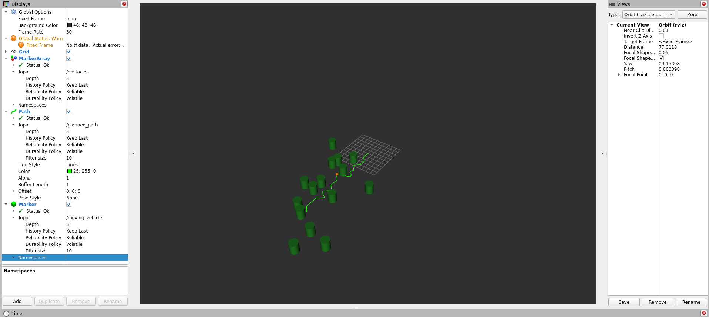

# AR3 Path Planner (ROS 2 Humble)

Egyszerű útvonaltervező és akadályelkerülő ROS 2 Humble csomag animált jármű megjelenítéssel.

## Szimuláció (RViz2)



## Csomag tartalma

1. **`obstacle_generator_node`**: Véletlenszerű hengeres akadályokat generál és publikál a `/obstacles` topicra (`visualization_msgs/msg/MarkerArray`).
2. **`path_planner_node`**: Tervezett útvonalat generál az akadályok kikerülésével a `/planned_path` topicra (`nav_msgs/msg/Path`), valamint egy mozgó narancssárga gömb markert animál a pálya mentén a `/moving_vehicle` topicra (`visualization_msgs/msg/Marker`).

## Fordítás és futtatás

```bash
cd ~/ros2_ws
colcon build --packages-select maj_ar3_path_planner
source install/setup.bash
ros2 launch maj_ar3_path_planner planner.launch.py
