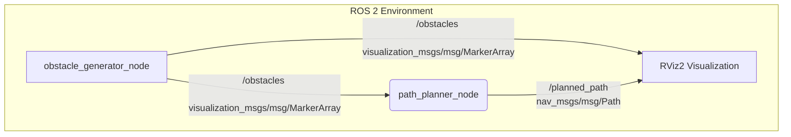

# maj_ar3_path_planner

**Hallgató:** Majoros Roland  
**Tantárgy:** Alkalmazott járműinformatika (AJR)  
**Környezet:** ROS 2 Humble Hawksbill  

---

## 1. Projekt áttekintése

A repó célja egy véletlenszerű terepakadályok (fák, hengeres akadályok) közötti autonóm útvonaltervező és kikerülő algoritmus elkészítése ROS 2 Humble környezetben.

A rendszer két fő komponensből és az RViz vizualizációból áll:
1. **Obstacle Generator Node (`obstacle_generator_node`):** Véletlenszerű eloszlású, paraméterezhető méretű és számú akadályokat generál és publikál.
2. **Path Planner Node (`path_planner_node`):** Feliratkozik az akadályok helyzetére, figyelembe veszi az előre definiált biztonsági sávot, majd dinamikusan generál egy ütközésmentes útvonalat a startponttól a célpontig.
3. **RViz2:** Megjeleníti az akadályokat (3D hengerek) és a tervezett útvonal trajektóriáját (`nav_msgs/msg/Path`).

---

## 2. Rendszerarchitektúra és folyamatábra (Mermaid)

Az alábbi diagram szemlélteti a ROS 2 csomópontok közötti adatfolyamot és topic-kapcsolatokat:


## 3. Topic és Interface leírások

| Topic neve | Típus | Leírás |
|---|---|---|
| `/obstacles` | `visualization_msgs/msg/MarkerArray` | Az akadályok (fák) koordinátái, magassága és kiterjedése. |
| `/planned_path` | `nav_msgs/msg/Path` | Az akadályokat kikerülő tervezett útvonal pontjai (PoseStamped). |

## 4. Telepítés és fordítás

A csomag szabványos ROS 2 Humble munkakörnyezetben (colcon) fordítható:

```bash
# Workspace mappába lépés
cd ~/ros2_ws/src

# Repó klónozása
git clone https://github.com/majorosroland/maj_ar3_path_planner.git
# Függőségek ellenőrzése
cd ~/ros2_ws
rosdep update
rosdep install --from-paths src --ignore-src -y -r

# Fordítás
colcon build --packages-select maj_ar3_path_planner

# Környezet betöltése
source install/setup.bash
```

## 5. Futtatás

A rendszer egyetlen launch fájllal indítható, amely elindítja mindkét node-ot és az RViz-t:

```bash
ros2 launch maj_ar3_path_planner planner.launch.py
```
